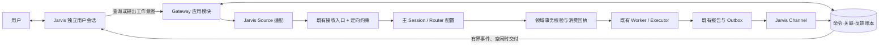

# Jarvis Gateway 开发前方案

版本：D2，2026-11-13。本文保留开发前设计及静态评审依据；后续已获授权实施，当前代码与运行验收状态见 [实施记录](jarvis-gateway-progress.md)，设计意见见 [评审记录](jarvis-gateway-review.md)。本文的计划条款本身不是测试通过证据。

## 授权与工作记录

2026-11-13 后续授权：用户已要求开始开发并持续推进；D2 进入实施，实际完成情况见 [实施记录](jarvis-gateway-progress.md)。下段“本轮只修改设计”保留为设计阶段历史，不代表当前实施被禁止。

用户要求：设计详细开发前方案，写明目标、只做什么／不做什么、全部关键约束、模块划分与抽象，然后评审。本轮只修改设计及约束文档，不实现业务代码、不安装依赖、不启停服务、不修改日常 DSH 环境，也不创建或发布真实 Issue／PR。

已确认的产品方向以 [项目约束](../AGENTS.md) 为准。本方案的接口、文件划分和第一阶段范围属于供评审的实施设计，不冒充此前用户已逐项确认的需求。

本方案采用一个推荐实现，不以多个备选方案代替决定。以下新增接口、首期限制和底座扩展是评审对象；开发阶段必须以评审修订版和用户后续授权为准。静态代码依据与运行验证严格区分。

## 1. 要达到的目标

用户把一个明确的工作交给 Jarvis；请求可靠入队后即可继续对话，superagent 在后台执行。用户能补充原任务要求、回答它提出的问题、查询进展或明确停止任务；最终得到与原目标对应的结果和验证证据。

首期先用普通本地任务验收真实宿主中的交办、后台执行、期间继续对话和结果回传。2026-11-13 用户质疑 Issue→PR 是否必须后，已撤回将测试 Issue 链接作为继续开发前提的要求；Gateway 的输入与交付不依赖 Issue／PR。此前讨论的 GitHub Issue → 可审查 PR 保留为 GitHub 场景专项，开展时使用专门测试范围，不自动合并、发布或操作生产环境。受控模型／外部 CLI 的 fixture 通过不等于真实模型质量或真实 GitHub 业务验收；底座已有仓库／账号部署要求也不因本次澄清消失。

| 编号 | 目标与可观察结果 |
| --- | --- |
| G1 | 不丢交办：显示“已收到”之前命令已持久保存；响应丢失、刷新和重启可找回同一回执。 |
| G2 | 协议内定向：携带 command／trigger 来源的命令只向固定目标产生领域副作用；明确给 A 的命令不能被 receive／route／重评估投给 B 或改为另一新任务。此保证不包含原主 Session 所有无来源管理工具的内容隔离，见第 8.3 节。 |
| G3 | 前台可用：后台仍在执行时，Jarvis 本轮已经结束，下一条用户消息能被接受；不等待 Worker 完成。 |
| G4 | 少打扰：普通进度归并；问题、重要异常和待验收结果保留稳定身份、来源和关联，不重复轰炸用户。 |
| G5 | 可核查交付：完成、失败、停止、待验收分别表达；保留原始要求、任务引用、结果链接及已有验证证据，不把模型承诺当验收。 |
| G6 | 有界上下文：存在 100 个任务时，查询只提供相关的一页摘要和必要详情，不把全部历史注入 Jarvis。此目标不代表首期承诺 100 个 Worker 同时执行。 |

## 2. 首期只做什么／不做什么

### 2.1 首期实施范围

1. 同一 DSH 插件包内增加 Gateway 模块及 Jarvis Source／Channel；Jarvis 与主调度 Session 保持分离。
2. 五种用户行为：新交办、对已关联任务追加要求、回答当前问题、只读查询、明确停止任务。其中四种写操作分别为 `new`、`append`、`answer`、`stop`，查询不进入执行消息链。
3. 持久命令账本、稳定关联、投递恢复、领域消费回执、反馈收件箱，以及相关状态的只读投影。
4. Jarvis 高层工具和短回合策略；前台必要的回执、任务引用、问题回复关联及后台消息显示。沿用当前白色对话界面，不另做任务管理大屏。
5. 首期写入仅覆盖通过本 Gateway 建立并绑定的工作；对 GitHub／飞书已有任务的自动接管、绑定和回传镜像不纳入。贴一个 Issue 链接是引用资料，不自动取得其既有 Ticket 的管理权。发现已有相关任务时返回候选和范围说明，不能静默另起重复任务或假装已经接管。
6. 只针对当前单用户、单部署、单仓库；保留部署／用户归属标识防止混用，不扩展为多租户系统。
7. 用独立联调环境验证构建、宿主兼容、任务执行和重启恢复，原有 Jarvis 设置、会话、工具管理必须回归。

上述首期范围是本次实施设计建议，不把历史 Demo 的授权扩大为真实代码执行或对外发布授权。

### 2.2 明确不做

- 不加 Jev 等前置意图模型，不增加秘书 Agent、管理 Agent、第二个 Router 或新的 Worker 团队。
- 不自建调度器、任务引擎、授权引擎、模型工具循环；不复制 Ticket／Mandate／Assignment 状态机。
- 不实现任意任务转投、合并、拆分、批量操作、跨仓库接管或修改优先级体系。
- 不实现后台任务自动重开、自动重试失败的业务任务、自动批准扩权；传输重试与任务重做分开。
- 不扩展经营概览、技能市场、提醒偏好、长期记忆、向量数据库或外部消息通知渠道。
- 不引入外部队列服务、独立 Gateway 服务进程、通用插件框架、通用工作流 DSL。
- 不重写现有 GitHub／飞书 Source，不把其消息伪装成 Jarvis 用户授权。
- 不顺便升级依赖、清理全仓代码、迁移旧会话或删除原数据库；不默认把 Windows 支持扩成全套底座移植工程。
- 不承诺自然语言意图零错误或跨系统“恰好一次执行”；本方案保证范围是有来源的命令协议、目标约束、幂等消费和可恢复反馈。

## 3. 现有代码依据与缺口

以下是开发前的静态核查事实，保留为最小改动依据；实施后的受限入口及验证见实施记录。

| 事实与来源 | 对设计的约束 |
| --- | --- |
| [SourceContext](../src/sources/host.ts)、[sourceContextOf](../src/app/source-context.ts)：公开 receive、Source KV、Thread／Ticket 读取等；没有条件目标提交接口。 | Source 插件通过宿主公开边界接入，不能强转 Runtime 取私有 Engine／Store。新增能力要声明契约。 |
| [Intake.receive](../src/core/intake.ts)：对所有 Trigger.threads 的 subscriptions 分发 Input，再按条件 Eval。 | 不能把整段用户聊天或所有引用链接放进执行 Thread；后置路由无法撤销先前误投。 |
| [Engine](../src/core/engine.ts)、[main tools](../src/app/tools/main.ts)：decide／attach 原子执行，但 Router 可自行选择 accept／attach／stop。 | 仅提示词、入队前检查或 UI taskId 不足以约束最终目标。 |
| [Tickets.attachable](../src/core/tickets.ts)：人工停止拒绝；ended 任务检查 Mandate；并非对新命令再执行完整的来源 gate。 | 定向追加／回答需要在提交事务内核对当前命令的来源准入，不能把选中 Ticket 当授权。 |
| [Evals](../src/core/evals.ts)、[EnginePart](../src/core/part.ts)、Tickets：handback、letGo、reevaluate 可再次进入评估。 | 定向约束必须持久保存，跨重新评估、重启仍生效。 |
| [Replies](../src/core/replies.ts)：结果回 origin Channel；多种 purpose 最终合并为 reply，当前 OutboundMessage 未完整保留问题身份。 | Jarvis-origin 先闭环；类型化反馈必须补明确信息，不能按自然语言猜问题与结果。 |
| [Outbox](../src/app/outbox.ts)、[AgentDelivery](../src/app/delivery.ts)：已有持久重试、稳定消息 ID、history／inbox 去重、Session flush。 | 复用其语义和已验证模式；不同数据库之间仍需幂等恢复，不能虚构统一事务。 |
| [JarvisRuntime](../jarvis/dsh/runtime.mjs)、[Store](../jarvis/store.mjs)、[chat.js](../jarvis/public/chat.js)：active 等待 whenIdle；SQLite 只有 settings／turns；清空会换 DSH Session 并删除 turns。 | 需要后台收件箱、稳定逻辑会话身份和独立的消息投影；不能仅把 Worker await 换成裸后台 Promise。 |
| package／profile：根项目声明 alpha.2，本机已验证 Jarvis 的宿主是 rc.5；完整底座未构建／启用。 | Jarvis 可聊天不等于 superagent 可执行，宿主兼容是独立前置门禁。 |

## 4. 总体架构与职责



- **Jarvis**：理解与讨论目标，提出有限操作，按需读状态，对用户表达进展与交付。原始用户内容与模型摘要分别保存；模型不创建可信身份、授权或底层 Thread ID。
- **Gateway**：解释有限命令协议，解析稳定引用，持久登记，交付与恢复，归并反馈。它是代码模块，不进行额外模型决策，不执行具体任务。
- **Source／Channel**：把 Gateway 请求映射到既有 Trigger／来源策略／回执渠道，接收底座输出；没有私有旁路。
- **superagent**：仍负责当前策略下的准入、主会话路由、工单与执行生命周期、验证报告。新增约束只缩小某条命令允许的目标与操作，不能赋予更多权限。
- **DSH**：管理模型、工具运行与会话持久化。后台反馈是插件来源消息，不伪装成人发送的消息。

## 5. 模块划分与抽象规则

以下为建议落点；文件数量不是验收指标。同一职责的少量类型／函数可以合并，不为每个接口造类。

| 模块／建议位置 | 输入、输出与拥有的数据 | 依赖与禁止事项 |
| --- | --- | --- |
| `src/jarvis-gateway/contracts.ts` | 命令、引用、回执、事件和错误类型；边界 schema。 | 无 DSH、数据库、网络副作用；不另定义 Ticket 状态。 |
| `src/jarvis-gateway/service.ts` | 提交／查找／查询，命令去重和关联判定；协调仓储与 Source 端口。 | 显式注入 Ledger、Backend、Clock；无全局 currentTicket；不读取 Worker 内存。 |
| `src/jarvis-gateway/ledger.ts` | Gateway SQLite 的命令、关联、原始来源与收件箱事务。 | 不打开 superagent 数据库；不把该账本变成第二个工单数据库。 |
| `src/jarvis-gateway/source.ts` | 注册 Jarvis Source／policy／context reader／Channel；Trigger 编解码、回执与快照读取。 | 只依赖 SourceHost／SourceContext 公共接口；不直接调用 Worker。 |
| `src/jarvis-gateway/pump.ts` | 有界取出待投递命令、查询未知结果、回收过期占用、处理反馈；从持久状态恢复。 | 生命周期归 DSH；内存计时器只是唤醒器；无模型轮询、无内存唯一任务表。 |
| `src/jarvis-gateway/index.ts` | Cordis 服务与插件装配、关闭流程。 | 新增包子路径与构建入口；缺失 Gateway 不应令原 Jarvis 聊天无法启动。 |
| `jarvis/dsh/gateway.mjs`（建议新增） | Jarvis 高层工具注册、绑定可信用户轮次、消费后台事件、DSH 投递。 | 不依赖 superagent 私有模块；调用 Gateway 服务契约；不保存另一份命令权威状态。 |
| 现有 runtime／store／chat 的必要修改 | 逻辑会话与 generation、区分用户轮次／后台通知、UI 投影、停止和清空语义。 | 保留设置与模型能力；避免把 Gateway SQL、路由、业务投递塞进 runtime。 |
| 领域约束及 Source API 最小扩展，见第 8 节 | 可选命令约束、消费回执、类型化反馈与只读结果接口。 | 保持核心不依赖 Jarvis、DSH 或 UI；普通来源保持原有行为。 |

新增 TS 模块放在 `src/jarvis-gateway/`，以便使用现有 tsconfig／Vitest／tsdown；同包导出建议为 `dsh-superagent/jarvis-gateway`。Jarvis 现有 `.mjs` 不整体改写为 TS。发布清单必须包含实际依赖文件，并做包内容校验。

只引入三个有实际边界的依赖：`GatewayLedger`（持久化）、`SuperagentBackend`（既有来源宿主）、`JarvisDelivery`（会话交付）。不用 Repository 基类、全局事件总线、策略工厂或跨模块共享可变单例。纯计算包括规范化、引用解析、指纹、事件分类与归并；事务和 DSH 调用留在适配处。

## 6. 身份、数据与权威归属

| 对象 | 规则 |
| --- | --- |
| `deploymentId / principalId` | 后端从受信任的本地配置和已认证入口绑定；单用户不等于模型可以任意自报身份。不是 GitHub／飞书作者身份。 |
| `conversationId / generation` | conversationId 是 Jarvis 逻辑对话身份；generation 对应一次 DSH 上下文。显示名称和清空上下文不能改变任务归属。 |
| `userMessageId / actionSlot` | 来源于已持久的真实用户轮次。首期每个用户轮次最多提交一个有副作用操作；复合要求先澄清或分轮交办，不部分执行后隐瞒剩余部分。 |
| `commandId` | 服务端按部署、用户、原用户消息及动作槽确定并持久化；重试 attempt、模型 toolCallId 和时间戳都不是新的命令身份。 |
| `workRef` | 用户工作引用，可在创建 Ticket 前存在；只保存与权威 Ticket 的关联及版本，不自行判定“已完成”。一个已接纳的新命令最多绑定一个 Ticket；首期绑定后不可改绑、转移或换部署。 |
| `transportThread` | **每个有副作用命令独立一个 Thread**，由服务端生成，Trigger.threads 只有它。不同命令不复用该 Thread；长期 Conversation、workRef 和 Issue URL 均不是它。 |
| `triggerId` | 对 commandId 确定性生成；在“提交结果未知”的恢复中不更换。 |
| `targetToken` | 服务端返回的持久引用句柄，绑定部署／用户／workRef／Ticket／关联版本与控制条件；不是由模型拼出的 Ticket ID。新会话可重新查询取得。Gateway 在本地提交事务内校验后冻结目标，底座复核其拥有的任务控制状态；不声称两库共享 CAS。 |
| `questionToken` | 包含对应 Ticket 和当前 attention.id；在真正执行回答时再核对，不能仅在展示时核对。 |
| `eventId / deliveryId` | 原始回执 ID 或确定的状态转变标识；会话投递 ID 与它稳定关联，重启与网络重试不产生新事件。 |

建议新增独立 `jarvis-gateway.sqlite`：`commands`、`work_links`、`source_messages`、`events`、`deliveries`、`schema_version`。具体索引按访问模式建立：commandId 唯一；部署+用户+原消息+槽位唯一；triggerId 唯一；eventId 唯一；deliveryId 唯一；按状态／重试时刻和用户／工作关联分页。

逻辑会话与 DSH 的 `SessionBinding(conversationId, generation, dshSessionId, revision, status)`、清空切换记录归 Jarvis Store 拥有；迁移现有 `dsh-session` 设置后只保留一处权威绑定。Gateway delivery 保存当次绑定快照与表达状态，通过 Jarvis 适配器核对，不反向维护另一份当前 Session。两库间按明确的准备／确认阶段恢复，不在事务中等待模型或网络。

`commands` 保存不可变权威请求及哈希、原始文本、动作、目标和问题身份；辅助模型摘要是可读注释，不改变授权。`work_links`／快照缓存可从命令回执与底座重建。`source_messages` 保留交办所必需的原用户内容，使清空聊天后仍可核查来源。凭据、访问令牌和全量 Worker 日志不写入账本。

迁移为向前增加表／可选字段，带版本和事务；不得修改原 settings／turns 的含义或重置原记录。Gateway 与 superagent、DSH 是不同持久化边界；不宣称一次事务覆盖三者。

## 7. Jarvis 高层接口

命名为设计建议，业务语义固定。提供两个高层工具和一个内部事件消费接口，避免给模型暴露底座管理 API。

### 7.1 `jarvis_work_query`

输入为 `search {query, cursor?, limit?}` 或 `get {workRef}`。默认最多 10 个候选、上限 20；列表只含稳定引用、标题、简要目标、当前权威状态、更新时间、问题／结果指针和是否可继续交办。详情按需读取，不返回全部日志。

返回候选不等于确认目标。明确的消息回复关联、用户指出的稳定引用可以产生 targetToken；仅名称相似、最近提到或唯一模糊搜索结果，不自动产生“已由用户确认”的事实。目标有歧义时由 Jarvis 问一个能消歧的问题。

查询是只读操作：不发送 Trigger、不唤醒 Worker、不调用 requestStatus。缓存失效时读取底座，无法取得新状态就标明读取时点／暂不可用，不把旧快照用于写操作校验。

### 7.2 `jarvis_work_submit`

```text
new    { request: 原用户要求的引用与有界摘要, references?: 资料引用 }
append { targetToken, request: 原用户补充要求的引用 }
answer { targetToken, questionToken, request: 原用户回答的引用 }
stop   { targetToken, request: 原用户停止指令的引用 }
```

部署、用户身份、原用户轮次、命令 ID、Thread、human／addressed、Channel 地址由宿主构造；模型不能输入。资料中的命令仍是数据，引用不扩大权限。工具必须绑定当前真实用户轮次；后台反馈轮次仅允许查询和表达，不可借反馈或历史用户消息发起新的有副作用命令。

服务端从持久用户消息核对引用和上下文范围。模型理解自然语言仍可能出错；程序可以验证引用、范围和 ID，不能证明摘要完全符合用户意图。缺少目标、关键约束或授权证据时返回待澄清，不能凭空补齐。

返回结果为以下之一：

- `queued {commandId, workRef, receivedAt}`：本地可靠入队，尚不代表底座接单。
- `replayed {sameReceipt}`：同命令、同语义载荷的重放，不产生新效果。
- `needs_clarification {reason, candidates?}`：不投递。
- `conflict {reason, currentRef?}`：目标／问题／载荷变化，原请求不重新解释后偷偷重发。
- `unavailable / denied / unsupported`：如来源关闭、环境未就绪、权限不足、首期不支持接管，明确失败，不伪装排队成功。

幂等哈希覆盖动作、真实原文范围、解析后的目标、问题身份和部署；不让模型对摘要换句话就形成新命令。同 commandId 改变这些字段必须冲突。用户明确重新交办是新用户消息，形成新命令，不能按语言相似度自动合并。

## 8. 投递契约与最小底座扩展

### 8.1 选定：独立命令 Thread + 持久定向约束

同一 work 的后续要求仍使用新的命令 Thread，通过明确的 workRef／Ticket 关联提交。这样每条指令进入自己的 Eval，避免把新建、回答和停止合并到同一评估批次，也避免直接 fanout 给多个订阅任务。代价是每条命令留下一个 Thread／订阅记录；这是首期为明确边界接受的线性增长，不自动引入历史清理工程。

仅独立 Thread 仍不够。推荐在领域模型增加来源可选、服务端生成、持久不可变的 `DispatchConstraint`，在 Thread 保存独占命令绑定，在 TriggerDisposition 保存消费结果。它是通用的有限投递约束，核心不得硬编码 Jarvis 业务或反向依赖 Gateway。

建议契约：

```text
DispatchConstraint {
  commandId, payloadHash,
  operation: new | append | answer | stop,
  targetTicketId?: string,
  attentionId?: string,
  bindingRevision, controlPrecondition,
  expectedInitialRecipients: []
}
ConsumptionReceipt {
  commandId, payloadHash,
  outcome: applied | ignored | conflict | denied,
  decisionId?, ticketId?, inputId?, attentionId?, reason?
}
CommandThreadBinding {
  ownerCommandId, ownerTriggerId,
  allowedTicketId?: string // new 消费时一次性绑定；其他命令在接收时固定
}
```

`controlPrecondition` 只覆盖底座拥有的 Mandate 身份、任务是否 ended／人工停止、回答的问题身份；普通进度更新不应使其无故失效。Gateway 的关联版本在其入队事务内校验，入队后目标不可变且首期没有改绑操作。当前策略仍在消费时重新裁决，约束不是权限凭证。具体字段随现有类型确定，禁止伪造一个当前不存在的全局 Ticket version。

### 8.2 两个原子校验点

**接收入库事务**：同 ID 同载荷先返回已有回执；同 ID 改载荷拒绝。新命令验证来源、归属、唯一命令 Thread、Thread 未被其他工作订阅、预计接收集合为空，再存 Trigger／约束。首次占用的 Thread 还必须没有其他历史 Trigger、pending 或 evaluating；不能占用只是订阅为空的普通 Thread。校验失败不得先 fanout、写执行 Input 或唤醒任务。重复请求必须先按历史回执处理，不能因为 Thread 后来已有订阅而把成功重放误报为新冲突。

**Thread 独占不变量**：接收第一条命令时，在同一底座事务内登记 ownerCommandId／ownerTriggerId。之后所有 receive 均检查该绑定，包括没有约束字段的来信；换 Trigger ID、删掉 constraint 或伪造来源都不能复用这个 Thread。subscribe、bindThread、followForContext 及 accept／attach 共用的订阅入口只允许已绑定目标；new 首次 accept 时原子绑定所建 Ticket，其他 Ticket 连只读订阅也不得占用该命令 Thread。已存在的普通 Thread 保持原有多订阅行为。任一 Eval 只要含 constrained Trigger，其全部输入必须恰好属于该唯一 command／ownerTrigger，不得混入其他命令或普通无约束 Trigger；所有 decide 入口对已存在的违规混批均拒绝，不能借普通 Trigger 入口间接消费受限命令。

独占绑定不随 unsubscribe、任务终态或插件重启释放；new 只有其首次 applied 事务能绑定唯一新 Ticket，stop 命令不创建向目标传递 Input 的订阅。后续需要新指令必须创建新的 command Thread，不能循环使用旧空 Thread。

**最终消费事务**：Engine.decide／attach 执行领域变更前，检查该命令允许的动作与固定目标、当前来源仍 listened、当前 Policy.gate 为准入且显式、以及底座控制条件。SourceScope 与 Policy.gate 分别检查，不能只查其中一个；已有 Mandate 仍按原规则校验。写领域变化、消费回执和持久副作用必须同事务完成。模型提出的路由不能覆盖约束。约束和回执跨 handback、letGo、reevaluate、重启保留。

消费入口先检查不可变终局回执：已 applied 的命令直接返回原结果；handback／reevaluate 等后续事实可另存审计或状态解释，但不能再次 attach、改写 applied 或为同一命令创建新的领域效果。ignored／denied／conflict 的终局命令也不能借重评估改写；新的用户决定形成新命令。

| 命令 | 允许的领域处理 | 禁止／冲突规则 |
| --- | --- | --- |
| new | 在现有 gate 下 accept 一次；也可 ignore／拒绝。 | 不自动 attach 到另一任务或 stop；发现已有工作需要新的明确选择，不借本命令接管。 |
| append | 仅 attach 到绑定的、仍可接收的活动 Ticket。 | 不改投／新建；任务已结束时不隐式恢复，返回明确状态。人工停止保持不可恢复。 |
| answer | 对既定 Ticket attach，事务内 CAS 当前 attention.id，并登记该问题的回答消费身份。 | 过期／被替换／已消费的问题拒绝；不能把旧回答解释为新指令。 |
| stop | 经现有 explicit 准入规则对既定 Ticket 作 stop。 | 不以普通 human follow-up 唤醒 Worker 后再停止；已结束则返回当前终态，无重开副作用。 |

已有无约束 GitHub／飞书 Trigger 的 fanout、恢复和 handback 语义保持不变。对于带约束命令，Worker 退回超范围内容时可以报告需决定／未执行，但不能绕过约束将同一请求变成另一任务；新方向由新的真实用户指令确认。

同一 attention 的回答消费身份也必须位于底座事务内：仅 Gateway 去重不能防止两条不同用户消息同时回答同一旧问题。问题替换后产生新的 attention.id；不靠问题文本相同判断身份。

### 8.3 需要修改哪里、为什么

| 扩展 | 必要依据与界限 |
| --- | --- |
| core model／ports／intake／engine／evals／tickets 的局部约束与消费回执 | 现 receive 无期望目标，后续路由可另选目标，重试 attach 可产生额外 note／Input。新增持久独占 Thread 绑定并覆盖全部订阅入口；只有在事务内检查才能覆盖竞态；不改普通 Thread 的订阅及原有任务调度规则。 |
| SourceContext 的受限提交及结果读取 | 返回 command／trigger 的真实处理结果与有界 Ticket 快照；不能依赖 ack 文本猜是否接单，也不暴露整个 Store。具体契约为 `submitConstrained`、`commandReceipt`，名称可调整。 |
| app source-context／runtime 的装配，main tools 的约束展示与错误回传 | 把新能力接到现有 Engine；候选卡明确允许动作，工具错误可解释。最终保护在领域层，不能只写提示词。 |
| OutboundMessage 的可选关联信息、Replies 生成处 | 增加 `purpose / triggerId? / attentionId? / assignmentId? / reportRef?` 等结构化关联，现有字符串消息及 GitHub／飞书发送方式保持兼容；防止把旧问题／旧结果当成当前状态。reportRef 使用明确保存的报告身份或稳定指纹，不假定已有全局 reportId。 |
| 包导出／构建／默认关闭的插件注册 | 新模块随同包发布，在独立 profile 显式启用；不覆盖原 superagent 入口。 |

这是有代码依据的最小扩展建议，**不是宣称底座零修改，也不是本轮修改代码的授权**。实施时先建立针对性失败验证，再完成扩展；如果实际需要改变 Mandate 语义、原有来源行为或更大持久化迁移，返回设计评审，不自行扩展。

**保证范围与剩余风险**：来源约束保护可追溯的 Gateway 命令路径；主 Session 现有 note／retry／settings 等无 command／trigger 来源的管理能力仍在原有授权边界内。当前代码不能机械识别模型把某条命令改写成无来源 note 的语义关联，本方案不声称隔离了这一类任意工具行为。实现中禁止将这些独立操作登记为本命令的消费回执，提示词明确不得用其替代被拒绝的命令，但提示词不是安全证明。若目标提升为“主 Session 任意工具都不能向别的任务写入相关内容”，必须另做可信调用归因与能力收窄设计；不得用本方案的 G2 测试结果替代该隔离验证。这是保留既有主 Session 能力的明确限制，交付时需披露。

## 9. 持久交办、状态与失败恢复

Gateway 账本仅管理传输状态：`queued → delivering → recorded`，或 `rejected / conflict`；delivering 有租约，过期先查底座 commandReceipt，再重放同一 triggerId。任务的“运行、等待、完成”等从底座读取，不另作生命周期推进。

`recorded` 表示底座记录了命令；`applied` 表示底座已消费；新建的 applied 才能绑定 Ticket。Worker 是否启动、是否可交付另读权威快照。ignore／策略拒绝必须回传，不让用户无限等“排队中”。

受限 Source 的 `commandReceipt` 还需返回等待评估、applied、ignored、denied、conflict、unavailable 的结构化处理结果。路由提出错误动作属于一次被拒绝的尝试，保留审计但不消费命令，允许主 Session 修正为原约束允许的动作；不能自动改原 payload。来源撤销、控制条件失效等确定冲突保存终局拒绝，普通 ignore 保存终局 ignored；现有 Eval 重试耗尽／不可用必须投影为 unavailable。终局结果不能只藏在工具报错文本里。

Gateway 通过有界回执对账，将每个终局失败／ignore 以 `commandId + outcomeRevision` 生成一次可恢复的解释事件；不依赖主 Session 再额外调用 reply 才让用户知道。底座存在已完成消费回执时返回原结果，不因当前权限或任务状态后来变化而把历史成功改成失败；这不允许产生新的效果。瞬时内部错误不伪装业务终局，保留待重试和可见故障状态。

`recorded + consumption pending` 单独保留在 pump 的持久工作集中，按 nextCheckAt 有界、退避读取 commandReceipt；不能把 recorded 当作无需再处理。终局回执、Ticket 关联及其可见解释事件在 Gateway 同一事务内投影；已绑定工作的快照对账另按 workRef 分页，不扫描全部聊天历史。

| 崩溃或异常位置 | 恢复动作 |
| --- | --- |
| Gateway 提交事务之前 | 没有 queued 回执；同用户消息重试可以创建同一命令。 |
| Gateway 已落盘，HTTP／工具返回丢失 | 查相同 commandId 返回同回执；不新增命令。 |
| receive 已提交，Gateway 尚未记 recorded | 以确定 triggerId 查询底座；存在则恢复，不换 ID。 |
| route 已完成、消费回执响应丢失 | 读取原子写入的消费回执；不得再次 attach 或重建 Ticket。 |
| dispatch 遇到瞬时错误 | 有上限退避重试，保留错误和 nextAttemptAt；权限／载荷／目标冲突不无限重试。 |
| Gateway 插件关闭或主机重启 | 命令留盘；恢复时验证部署身份、来源启用状态和当前权限，再继续。 |
| Worker 失败或被阻塞 | 反馈真实状态；传输恢复不自动重做业务任务。 |

处理器每次读取有界批次，注册在 DSH 生命周期中。不得用未登记裸 shell、孤立 Promise 或只在内存中的轮询维持任务。没有额外常驻服务。

## 10. 反馈、问题与前台会话协同

### 10.1 接收与分类

Outbox → Jarvis Channel 时，Channel 先把事件以稳定 ID 写入 Gateway 收件箱，成功后才返回 `sent`；这里 sent 仅表示接收方可靠保存，不代表用户已看见。重复发送返回已有事件，不重复生成通知。

结构化 purpose、Ticket／Trigger／attention 身份保留；旧的没有这些字段的回执最多作为普通来源消息显示，不能凭文本生成可执行问题按钮。对当前问题／结果投影仍需读取对应的权威快照；问题已经替换时保留审计记录、停止旧问题的操作入口。

普通状态只更新快照，按 workRef 归并；ack 更新关联和状态，原则上不唤醒模型。问题、重要异常、待验收结果进入有界通知批次。后台运行协调器可做有界只读对账以恢复丢失的唤醒，不能每轮为每个任务调用模型或唤醒 Worker。

**反馈保证范围**：首期保证所有已经生成并提交的 Jarvis Outbox 消息可靠接收，以及当前仍可行动的问题／异常／结果最终可从权威快照恢复；不保证重放两次读取之间发生又消失的全部状态转变。已过期问题仅留审计，当前未答问题持续可见。快照补偿事件与 Outbox 事件用 attention 身份或 assignment／reportRef 等语义键关联，归并时保留各原始生产者回执，防止同一问题／结果被表达两次。若未来要求完整事件日志或跨来源镜像，另行设计事务内语义事件出口，不把普通快照查询冒充事件日志。

### 10.2 Jarvis 投递与忙时处理

1. 用户轮次优先；Jarvis 正在回复时，后台事件先留在持久收件箱，不并发向同一 Session 写入，也不插进当前回答中改变其用户目标。
2. 空闲时先持久保存一个不可变批次 manifest（事件 ID／版本、目标 generation、内容哈希），投递一个带插件来源的 DSH 消息；新的事件不能重新组成含同一已占用事件的另一批。eventId、batchId 与 expressionAttemptId 分开；同一次 attempt 的 deliveryId 稳定，检查 Session 历史与 inbox，并在 flush 后登记已接收。
3. 不能用目前面向真人的 `sessionController.prompt` 伪造后台用户消息。参考已存在 AgentDelivery 的 producer-source 与持久化模式；实际 rc.5 能力须专项验证。
4. 后台轮次中有副作用交办工具禁用，只能查询与表达。后台资料／Worker 报告不是用户批准。
5. Session 已收到但模型未完成时，按该输入的 inbox splice、消费 turn 和最终 assistant/message 证据恢复，不能用整台 Agent 的 whenIdle 当这条消息完成。模型失败／取消时将表达 attempt 记为未成功，事件仍留在收件箱；重试表达必须先确认旧 attempt 不再待处理，再分配新 attempt，仅重述已有事件，不重新交办任务。
6. 增加按游标读取通知／消息投影的 Web 接口；HTTP 推送只是可选唤醒，刷新可从持久游标补齐。UI 不再假定每条消息都是一对 user／assistant，不制造假“用户说了……”气泡。

同一批通知数量及文本体积有界：建议最多 10 条摘要、保留未消费余项；问题不被普通进度覆盖。用户持续输入时可显示轻量待处理计数，不强制抢占正在进行的用户轮次。具体数值为初始实现参数，压测后调整，不新增用户设置页。

表达状态机单独持久保存：`pending → reserved(manifest) → admitted-to-DSH → assistant-committed → projected-to-UI`；另外有 `retryable / parked / superseded`。admitted 只表示输入经 flush 后可恢复；assistant-committed 要有匹配的最终回复和持久屏障；projected 要有 UI 唯一消息键。进程崩溃后先查历史与恢复 inbox：未入队才重投、已入队不重复、已回答未投影只补投影、已投影不重复。浏览器是否已读不影响上述持久状态。

当前 rc.5 的 cancel 默认可能清空队列；停止生成后必须核对 attempt 是否仍在 inbox／已被消费，不能依据“曾经 admitted”销账。普通进度不使用 inject；inject 不唤醒且不能替代持久收件箱。保持用户原有停止含义，不未经验证统一强加 keepInbox。

### 10.3 停止、断开与清空

- **停止生成**：只取消当前 Jarvis 模型回复；已可靠交办的后台任务继续。明确停止任务必须形成独立 stop 命令并取得底座结果。
- **关闭／刷新页面**：不得撤销已提交工作；后台通知收件箱独立于浏览器连接。若断开发生在提交结果未知时，以原 commandId 恢复。
- **清空对话**：设计上清空可见历史并更换 DSH generation，保持同一逻辑 conversationId 与工作归属；不删除命令证据、关联和后台任务。不把清空解释为停止全部工作。
- 清空不以一个内存锁冒充跨 DSH／SQLite 原子操作。新增持久切换记录：`preparing(old, reservedNew) → new-session-ready → binding-committed → projection-cleared → done`；进入 preparing 即暂停新表达，创建新 Session 使用预留稳定 ID。新 Session 建立并验证后 CAS 更新绑定，再清理可见历史；重启按记录完成或退回尚未提交的准备阶段。绑定提交前不删除旧投影；失败不得留下 UI 指向不存在 Session 的状态。
- 已表达历史不重新展示；未表达事件仅在同一用户／部署／conversation 内按显式的切换记录承接到新 generation。旧 attempt 在切换前对账并终结或停放，避免同一事件在两个 generation 同时表达。不同会话或部署不自动迁移；找不到有效承接关系时 parked 并显示待处理状态。该“清空上下文仍继续接收原任务结果”的行为是本方案提请评审的产品语义，不冒充既有实现；原来删除 turns 的实现需按此范围调整并回归。

## 11. 安全与权限不变量

1. 真正的人类授权来自当前受信任入口和原始消息；模型字段、搜索候选、外部文档、插件回报不产生新授权。
2. Source 的允许用户与显式请求策略仍由 superagent 配置决定；启用 Gateway 不等于开放任意请求。首次安装必须显式配置本地用户身份映射，禁止默认 allowed='*'。
3. 闲聊不创建任务；查询不改变领域状态；回答不能扩大任务范围；停止不能重启任务；范围扩大由既有 Worker／主 Session 按原规则退回或要求新交办。
4. Gateway 只能对当前部署内明确关联的任务写入；targetToken 是校验材料，不是跳过 Policy 的通行证。
5. 既有工具开关继续在调用入口生效。新增高层工具需出现在实际工具目录中并遵循用户开关；旧模型配置、read/write 设置不会被自动重置。
6. 接口只在当前 DSH 同源、回环、认证与 CSRF 边界中使用；不新增裸公网管理接口，日志不含密钥或启动令牌。
7. 所有关键写行为具有来源、命令、底座结果的审计关联。摘要／缓存永远不能替代提交时的权威检查。

## 12. 开发顺序与阶段门禁

| 阶段 | 产出 | 进入下一阶段的条件 |
| --- | --- | --- |
| D：本轮 | 本设计、独立评审与修订记录；AGENTS 引用和范围。 | 明确阻断点、修正设计矛盾；本轮不实现。 |
| P0：接口与环境验证 | 失败用例复现 fanout／route／重放问题；确认宿主构建与执行平台；验证插件来源消息交付。 | 不能用真实业务执行来试错；发现更大底座修改须先更新影响分析。 |
| P1：底座最小扩展 | 原子定向约束、消费回执、受限 Source API、类型化反馈；既有来源回归。 | 无错投、重试副作用或授权回归；不得先接真实 Jarvis 写工具再补保护。 |
| P2：Gateway | Ledger、Source／Channel、投递与恢复、查询、反馈归并。 | 受控模型与进程故障注入通过，关闭／重启可恢复。 |
| P3：Jarvis 接入 | 高层工具、用户轮次来源绑定、空闲通知与 UI 投影、清空／停止语义。 | 后台运行时可继续对话，后台消息不能发起新授权命令。 |
| P4：联合验收 | 普通本地任务经真实宿主与 Worker 执行、前台继续对话、结果回传；补充／问答／停止／异常及重启。GitHub Issue→PR 另列专项。 | 实际调用、状态与证据一致；明确受控模型和外部服务边界，未执行场景不冒充通过；不等待 Issue 链接才验证通用链路。 |

### 环境前置条件

本机目前只有 Jarvis profile，根依赖和构建产物尚缺；不得在本轮安装或改动。后续先确认完整底座在支持的运行环境可构建和执行，并核对 alpha.2／rc.5 兼容性。现有服务脚本依赖 tmux／fcntl，原生 Windows 直接执行该脚本不成立。

推荐优先核查已有 Linux／WSL 环境是否可复用，以同一宿主运行完整插件；本方案没有确认机器上已安装 WSL，也没有授权迁移现有 4318 实例。若选用原生 Windows 需要超出最小启动适配的底座移植，单独提范围和影响，不塞进 Gateway 开发。

2026-11-13 实施核查纠正：上段是设计阶段的环境建议，不是 Linux 硬前提。服务管理脚本的 tmux/fcntl 依赖不在插件 `apply → Runtime` 的加载路径中，原 Router/Worker 预设已有 Windows PowerShell 分支。用户指出平台判断有误后，改为优先核验当前 Windows 的独立 DSH profile；只有实际复现的运行兼容问题才形成最小修复或范围决策，不再因缺少 Linux 环境直接停止验证。

原 4317、4318 和日常 DSH 配置保留；联合验收采用新的独立 profile、状态目录和日志登记。模型凭据由用户在设置或既有安全配置中提供，不在开发聊天索取、不复制进设计文档。

## 13. 验收矩阵与验证方法

以下为设计阶段确定的验收要求；逐项实际证据与限制记录在实施记录及其完成度审计中，不能仅凭本表判定通过。

| 编号 | 场景／故障注入 | 通过标准 |
| --- | --- | --- |
| T01 | 新交办入队及 Router 接纳 | 回执阶段准确；一个命令最多一 Ticket；完成条件与原要求可追溯。 |
| T02 | 100 个任务含同名／近似名 | 有界查询；模糊指代不写入；选定 A 后 B 不接收该命令 Input。 |
| T03 | Thread 意外多订阅、已有普通历史／pending／Eval、入队前引用失效；同 Thread 换 ID／去约束复用；其他任务 bind／followForContext；普通与 constrained Trigger 混批并从普通入口 decide | intake／订阅入口／最终提交拒绝；没有先投递再报错，不借普通入口消费受限命令；首期禁止已绑定 work 改绑。 |
| T04 | Router 为 append 选择 B、accept 或 stop | 领域入口拒绝；重启、handback、letGo、reevaluate 后仍拒绝。 |
| T05 | 同 commandId 重放／改变 payload | 相同载荷原回执；不同载荷冲突；提交后回执丢失不追加第二条 Input／note。 |
| T06 | 两条消息回答同一 attention；问题在执行前被替换 | 旧问题／重复回答消费被阻断；不产生第二次有效回答。 |
| T07 | Policy 撤权、来源关闭、目标人工停止或已结束 | 按真实当前条件拒绝或返回终态；不恢复、不扩大授权。 |
| T08 | 外部资料注入指令、后台轮次试图 submit | 不冒充用户；无新命令／无新权限。 |
| T09 | 只读查询、无来源管理操作与命令回执混淆 | 查询无 Trigger／Input／wake；note／retry 等独立操作不能被记为命令消费成功；任意无来源内容隔离不属于该测试证明范围。 |
| T10 | Gateway 落盘／底座 receive／route／Outbox 后分别崩溃 | 相同 ID 恢复；每个阶段有持久证据；不靠进程存活。 |
| T11 | 会话投递前后、flush 前后崩溃；cancel 清空 inbox；生成失败；重启重新组批 | 批次／attempt 有持久证据；未表达不销账，已表达只补投影；原始问题／结果可恢复，无假用户授权。 |
| T12 | Jarvis 正在回答时连续反馈；浏览器离线 | 用户轮次不被改写；通知归并且可刷新补齐；问题不被进度吞掉。 |
| T13 | Worker 持续执行，用户发第二条聊天 | 第一轮交办不等待 Worker；第二条能正常接入；单 Session 无并发写入。 |
| T14 | 停止生成／停止任务；清空各切换阶段后崩溃 | 三者语义分别生效；绑定与投影可恢复；同事件不在两代同时表达；不串到其他用户／部署，已入队工作不丢。 |
| T15 | 新增模块关闭、旧数据、无约束 GitHub／飞书消息 | 原有聊天、设置、工具管理可用；旧 fanout／恢复／授权行为保持。 |
| T16 | 普通本地任务实际执行、需要决策、执行失败／停止；真实 Issue→PR 另行专项 | 可审查结果与验证证据真实；错误和未完成明确回传；GitHub 专项未运行时单独注明，不自动合并。 |
| T17 | ignore、撤权拒绝、Eval unavailable、确定冲突，主 Session 未发 reply | 每个命令有真实结构化终局和一次可恢复的解释事件；不永久显示排队、不误报任务失败。 |

自动化测试优先稳定公共入口与持久副作用，不断言无业务意义的内部调用次数。推荐受控目标：100 条任务、每个查询返回不超过 20 条、后台状态事件风暴中模型轮次按有界批次增长而非按事件数增长。入队性能测量单独记录本机配置、样本和 p95，不把模型延迟与后台任务耗时混为一谈；初始本地无网络入队预算建议 p95 < 500ms，达不到先分析，不能修改测试掩盖问题。

### 验证命令与范围

- 根项目现有命令：`pnpm typecheck`、`pnpm test`、`pnpm build`；完整检查 `pnpm check`。新增 TS 测试遵循 `tests/**/*.spec.ts`，实际落点为 `gateway.spec.ts`、`gateway-routing.spec.ts`、`gateway-store.spec.ts`、`gateway-persistence.spec.ts`，执行记录另行保存。
- 重点复用并补充：`tests/core-engine.spec.ts`、`tests/tools.spec.ts`、`tests/policy.spec.ts`、`tests/sources.spec.ts`、`tests/registry.spec.ts`、`tests/store.spec.ts`、`tests/migration.spec.ts`、`tests/outbox.spec.ts`、`tests/delivery.spec.ts`、`tests/runtime-concurrency.spec.ts`、`tests/bundle-patch.spec.ts`。
- Jarvis 既有回归：`node --test jarvis/dsh/runtime.test.mjs jarvis/dsh/model-discovery.test.mjs jarvis/dsh/model-wire.test.mjs jarvis/model-picker.test.mjs jarvis/ui.test.mjs jarvis/server.test.mjs jarvis/capabilities.test.mjs jarvis/dsh/profile.test.mjs`。新增 Gateway 会话测试落点实施时登记，不能现在声称有可运行的新命令。
- 真实 DSH 联调按 `jarvis/DSH-INTEGRATION.md` 配置专用测试 provider；环境缺失导致 skip 必须报为未验证。完整检查的已核实失败基线与本方案专项结果见实施记录；Jarvis 既有 18 项通过是前次记录，不是本方案验收。
- 无业务代码改动的本轮只做文档核查和静态架构评审；后续 UI 改动需真实宽窄屏／消息流验证，语法检查不能替代。

## 14. 发布、回退与审查约束

- 新 Gateway 注册默认关闭；逐阶段启用先只读后写入。缺少保护能力、部署不匹配或不支持的持久数据版本时，写入口拒绝启动，不能降级成无约束 receive。
- 回退先关闭新命令入口、保留命令账本与收件箱、记录未完成项；不能为了回退删除队列。既有 Worker 是否继续运行由其原有生命周期决定，不把关闭 UI 当停止任务。
- 一旦底座保存带 DispatchConstraint 的命令，**不能直接用不识别约束的旧版本继续处理同一数据库**。必须带兼容保护回退，或隔离该测试状态目录；数据库格式相同不代表语义可安全回退。
- P0/P1 评审发现阻断性问题时先修设计，不以增加一个“审查模型”替代确定性校验。任何偏离本文目标／权限／模块边界的实现，需记录依据、影响、验证和复查结果。
- 本文成稿后进行独立评审，评审结论、修订与未关闭问题写入 [评审记录](jarvis-gateway-review.md)。设计评审通过也不等于运行验证通过。
